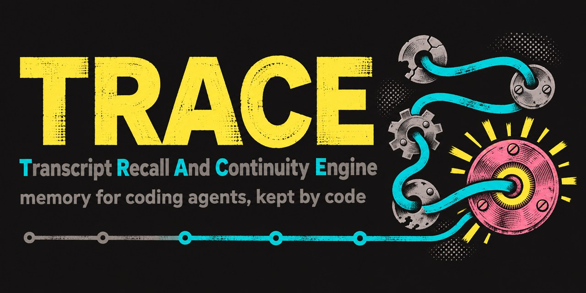

<p align="center">
  
</p>

# TRACE

[](https://github.com/diegolinan/trace/actions/workflows/ci.yml)
[](https://pkg.go.dev/github.com/diegolinan/trace)
[](go.mod)
[](https://github.com/diegolinan/trace/tags)
[](LICENSE)


**T**ranscript **R**ecall **A**nd **C**ontinuity **E**ngine: memory for coding agents, kept by code.

Author: Diego Liñan. License: Apache 2.0 (`LICENSE`, `NOTICE`).

In neuroscience, a *memory trace* is the physical mark a memory leaves, also called an engram. TRACE keeps that mark for an agent's sessions. When a session ends, is cleared, or loses its context to a compaction or a crash, the next one starts knowing what happened and where the work stopped.

## Why

A coding agent forgets between sessions. Claude Code's own answer is a model-written summary at compaction time, and it loses details:
- the user's exact words;
- commit ids and paths;
- what was decided and what was refused.

Claude Code also deletes transcripts after 30 days.

TRACE takes a different approach:
- **It keeps the record.** Every transcript is copied verbatim into one local SQLite file, by code, with no model in the loop.
- **It shows the facts.** Each new session sees the user's last words, the last reply and the last actions, quoted, not paraphrased.

## What it does

- **Import.** It reads every Claude Code transcript in scope into `trace.db`, incrementally. It also handles:
  - subagents;
  - transcripts that Claude Code rewrites or splices;
  - tool outputs that Claude Code keeps outside the transcript.

  Raw gzip copies of every transcript are kept next to the database.
- **Identity.** A session is known by its id, never by its name. Every name a session is given is kept as a dated label. A session's role comes from files in its own checkout, so moving or renaming a folder does not change it.
- **Hooks.**
  - Stop, PreCompact and SessionEnd: a detached import that returns at once.
  - SessionStart: a block that says where the last session of the same role stopped.
  - PreCompact: also fixed text that tells Claude Code's summarizer to keep quotes, ids and open work.
  - SubagentStart: tells helper agents that they are helpers, not the agent that started them.
- **Search.** Word and trigram search over everything stored.
- **Secrets.** API keys, tokens and private keys are redacted before anything is stored. The raw copies are not redacted: they are byte copies of files already on the same disk.
- **Marks (experimental).** Code rules mark a typed message that approves, rejects, corrects or sets a standing rule. Today the markers cover Spanish (including voseo) and English. They were scored against blind labels of real messages.

## Install

You need Go 1.27 or newer.

```sh
go install github.com/diegolinan/trace@latest   # puts trace in $(go env GOPATH)/bin
trace import                                    # first full import
trace stats
```

Then add the hooks to Claude Code's user settings (`~/.claude/settings.json`). Use the path of the binary you built:

```json
{
  "hooks": {
    "SessionStart":  [{ "hooks": [{ "type": "command", "command": "/path/to/trace", "args": ["hook"], "timeout": 30 }] }],
    "Stop":          [{ "hooks": [{ "type": "command", "command": "/path/to/trace", "args": ["hook"], "timeout": 10 }] }],
    "PreCompact":    [{ "hooks": [{ "type": "command", "command": "/path/to/trace", "args": ["hook"], "timeout": 10 }] }],
    "SessionEnd":    [{ "hooks": [{ "type": "command", "command": "/path/to/trace", "args": ["hook"], "timeout": 5 }] }],
    "SubagentStart": [{ "hooks": [{ "type": "command", "command": "/path/to/trace", "args": ["hook"], "timeout": 5 }] }]
  }
}
```

Claude Code reads hooks when a session starts, so restart open sessions after adding them. `trace stats` shows each hook run under "last runs".

## Commands

```
trace import                 read what is new in every transcript in scope; safe to run any time
trace hook                   for host hooks; never fails the host's turn
trace search <words>         [-n 10] [-who user|assistant|subagent] [-all] [-since 2026-11-01]
trace stats                  counts, last runs, hook output that never reached the session
```

## Configuration

TRACE's home is `$TRACE_HOME`, or `~/.trace` when that is not set. Settings are read from `<home>/config.json`. Every setting is optional, and without the file the defaults apply.

| setting | meaning | default |
|---|---|---|
| `data` | folder for `trace.db` and `raw/` | the home |
| `repo` | git repository for checking that a commit id in the text is real | no checks |
| `scope` | only project folders whose name contains this | every project |
| `user` | the person's name in the text the agent reads | "the user" |
| `roles` | named checkouts (see below) | every git checkout is its own project |
| `relay_tools` | tool-name prefixes whose results are another agent's words | none |
| `anchors` | extra tags, `name: regexp`, beside commits, paths and URLs (for example ticket ids) | none |
| `pin_phrases` | phrases that pin a typed message | "remember this" |

A role names a checkout by a file in its root, so it survives moves and renames:

```json
{
  "user": "Ana",
  "roles": [
    { "name": "lead", "label": "the lead agent", "git": "dir", "marker": "AGENT.md", "contains": "role: lead", "folder": "my-repo" },
    { "name": "worker", "label": "the worker agent", "git": "file", "marker": "AGENT.md", "contains": "role: worker", "folder": "worktrees-worker" }
  ]
}
```

- `git` is `"dir"` for a main checkout, `"file"` for a linked worktree, or empty for either.
- `folder` is the fallback when the session's folder no longer exists. It is matched against the end of Claude Code's transcript folder name, without case.
- When roles are configured, only those roles get the SessionStart block, the summary text and the helper line.

## Status

- **Used daily on Windows.** CI runs the tests on Linux, macOS and Windows; the hooks have only been used for real on Windows.
- **Codex is not supported yet.**
- **The marks are experimental** and not used by the hooks.
